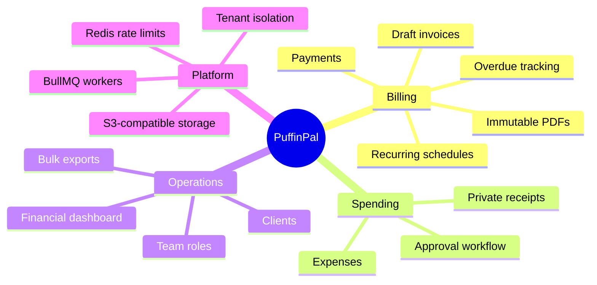
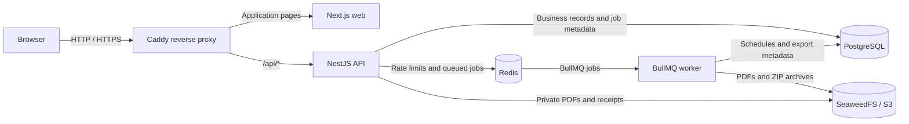
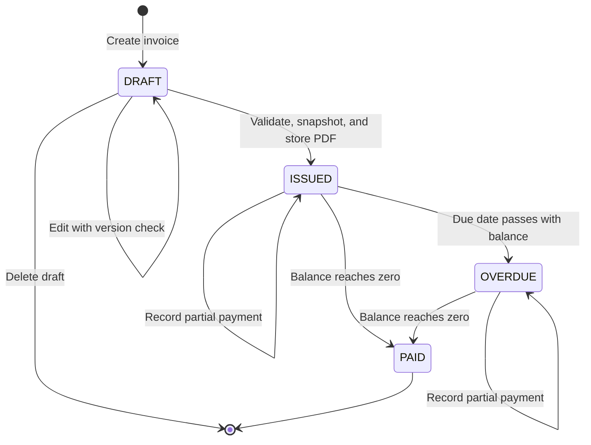
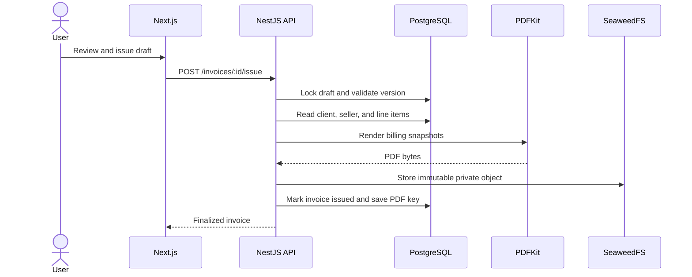
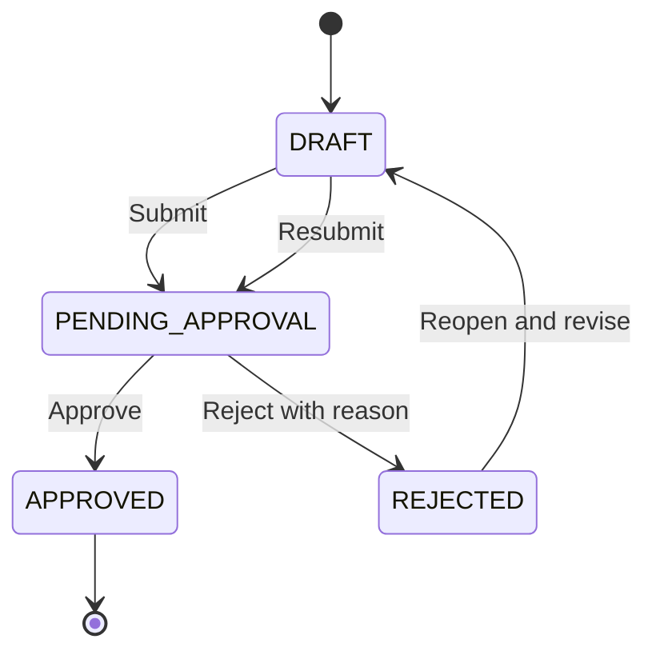
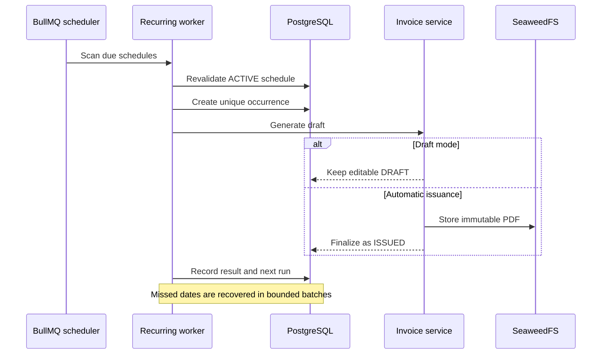
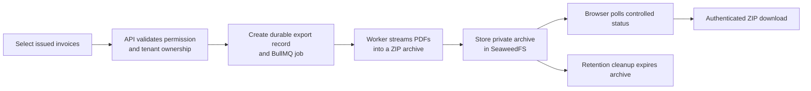

# PuffinPal

PuffinPal is a multi-tenant invoicing and financial management platform that helps businesses manage clients, invoices, payments, expenses, approvals, analytics, and recurring billing from one workspace.

It is designed for software and digital agencies, consulting firms, freelancers, IT service providers, and other small and medium-sized businesses that need dependable billing workflows without relying on disconnected spreadsheets and file shares.



## Features & Real-World Use Cases

The companies and scenarios below are fictional examples used to illustrate practical workflows.

### Multi-Tenant Organization Management

Every account belongs to an organization, and business records are scoped to that organization throughout the API and database access layer. Organization settings include a workspace identity, logo, and operating currency.

**Real-world example:** Cedar & Finch Consulting and Harborlight Creative both use PuffinPal. Their users work in separate organizations, so neither company can retrieve the other's clients, invoices, expenses, exports, or stored documents.

**Why it matters:** One application can support many businesses while keeping each workspace and its financial records isolated.

### Authentication & Role-Based Access Control

PuffinPal provides registration, login, short-lived JWT access tokens, refresh-token cookies, logout, password changes, and Redis-backed authentication throttling. OWNER, ADMIN, PROJECT_MANAGER, and FINANCE_VIEWER roles map to explicit permissions checked by the NestJS API.

**Real-world example:** Blue Oak Systems lets a project manager prepare invoice drafts and expenses while only an owner or administrator can approve expenses or issue invoices automatically.

**Why it matters:** Team members receive the access needed for their jobs without sharing owner credentials or gaining unnecessary financial authority.

### Team Management

Owners and administrators can view organization members, add users with supported operational roles, and update role assignments within the existing role hierarchy.

**Real-world example:** As Kestrel IT Services grows, its owner adds a finance viewer who can review records without being able to change billing data.

**Why it matters:** Access can grow with the business while remaining understandable and auditable.

### Client Management

Users can create, edit, list, and delete organization-scoped client profiles containing names, email addresses, companies, and tax identifiers. Invoice forms use these client records as the source for billing details.

**Real-world example:** Paper Kite Studio maintains profiles for 25 clients and selects the correct company when preparing each design invoice.

**Why it matters:** Reusable billing information reduces repeated data entry and prevents invoices from being associated with another tenant's client.

### Draft Invoice Management

Authorized users can create, edit, review, and delete draft invoices with ordered line items, quantities, unit prices, dates, and notes. Optimistic version checks prevent one editor from silently overwriting another editor's changes.

**Real-world example:** Lantern Software prepares a USD 4,800 invoice for a web application, reviews the line items with its project lead, and corrects the due date before issuance.

**Why it matters:** Teams can safely refine billing details before a financial document becomes final.

### Invoice Issuance & Immutable PDFs

Issuing a draft captures seller and client billing snapshots, validates exact totals, renders a PDF with PDFKit, and stores the document privately in SeaweedFS through its S3-compatible API. New issued invoices retain an immutable PDF; older issued invoices without stored files remain downloadable through the snapshot-based compatibility renderer.

**Real-world example:** Summit Row Architecture issues a USD 12,000 invoice. Later client-profile edits and partial payments do not alter the original issued document kept for accounting records.

**Why it matters:** The downloaded invoice represents what was actually issued, rather than today's mutable client or payment state.

### Payment Tracking & Overdue Invoices

Authorized users can record full or partial payments with dates, methods, references, and notes. PuffinPal calculates paid and outstanding balances, identifies overdue invoices from their due dates, and moves fully settled invoices to PAID.

**Real-world example:** Meridian Advisory receives USD 4,000 against a USD 10,000 invoice. PuffinPal records the payment and shows USD 6,000 outstanding until the remaining amount is received.

**Why it matters:** Teams can see collection status without changing the original invoice or maintaining a separate payment spreadsheet.

### Expense Management & Receipt Storage

Expenses support categories, dates, vendors, descriptions, notes, filtering, sorting, and private receipt attachments. JPEG, PNG, WebP, and PDF receipts are validated before storage in SeaweedFS and retrieved through authenticated API endpoints.

**Real-world example:** Brightfield Media records a USD 220 software subscription and attaches the vendor receipt to the same expense record.

**Why it matters:** Spending records and supporting documents remain connected and permission controlled.

### Expense Approval Workflow

Expenses can move through draft, pending approval, approved, and rejected states. Authorized reviewers can approve or reject submissions, submitters can revise rejected records, and append-only history records who performed each transition.

**Real-world example:** An employee at Alder Bridge Partners submits a USD 175 travel expense. An administrator reviews the receipt, approves it, and the expense then contributes to approved-expense reporting.

**Why it matters:** The workflow adds review and accountability before spending appears in financial summaries.

### Financial Dashboard & Analytics

The dashboard uses PostgreSQL aggregation to report invoiced revenue, collections, outstanding and overdue balances, approved expenses, and net cash flow across selectable periods. It also displays trends, invoice status distribution, expense categories, and receivables aging.

**Real-world example:** Mosaic Works reviews a month showing USD 38,000 invoiced, USD 29,000 collected, and USD 11,000 in approved expenses, then checks which receivables are more than 30 days overdue.

**Why it matters:** Business owners can understand billing and cash movement without combining multiple spreadsheets. Net cash flow here means recorded collections minus approved expenses for the selected period; it is not accounting profit.

### Recurring Invoices & Client Retainers

Recurring schedules support weekly, monthly, quarterly, and yearly billing with configurable intervals, start and end dates, due-date offsets, multiple line items, and active, paused, completed, or cancelled states. A schedule creates an editable draft by default; authorized owners and administrators can enable automatic issuance through the same snapshot and immutable-PDF workflow used by manual issuance.

**Real-world example:** Northstar Managed Services bills 12 clients for monthly support retainers. Each schedule prepares the appropriate invoice, while selected contracts issue automatically on their billing dates.

**Why it matters:** Durable occurrence records, bounded catch-up processing, retries, and database uniqueness constraints reduce repetitive work without silently losing or duplicating billing periods.

### Bulk Invoice PDF Export

Users can select eligible invoices and request a ZIP export. The API validates every invoice against the active organization, BullMQ processes the export asynchronously, the worker reuses immutable PDFs or historical fallbacks, and the completed archive is downloaded through an authenticated endpoint.

**Real-world example:** Shoreline Bookkeeping selects 40 month-end invoices and receives one ZIP archive instead of downloading each PDF separately.

**Why it matters:** Large document requests do not block normal API requests, and temporary archives remain private and expire according to the configured retention policy.

### Secure File Storage

Expense receipts, immutable invoice PDFs, and temporary export archives use private, tenant-scoped object keys in SeaweedFS. Invoice PDFs include organization and invoice metadata plus a SHA-256 digest that is verified when the file is downloaded.

**Real-world example:** Elm Street Research keeps receipts and finalized invoices available to authorized staff without publishing permanent public URLs.

**Why it matters:** Database authorization remains in front of file access, while large binaries stay outside PostgreSQL.

### Guided Onboarding

Newly registered users receive an interactive product tour that introduces the workspace and guides them through client and invoice actions. Progress is stored on the user record, the tutorial supports manual replay, and completed or legacy accounts are not automatically restarted.

**Real-world example:** A new owner at Fieldstone Design follows highlighted controls and suggested sample values to learn the client and invoice workflow before entering production billing data.

**Why it matters:** Users learn the product in context instead of reading a separate manual before they can begin.

### Responsive Workspace Personalization

The web application supports responsive layouts, light and dark themes, organization logos, user profile pictures, organization currency selection, and permission-aware navigation.

**Real-world example:** A freelance consultant uploads a profile photo and business logo, selects CAD as the organization currency, and uses the same workspace from a laptop or smaller screen.

**Why it matters:** The workspace remains recognizable and usable across common working environments.

## Technology Stack

### Frontend

- **Next.js 16 and React 19** provide routing, rendering, and the browser application.
- **TypeScript** supplies shared static typing across pages, forms, API clients, and components.
- **Recharts** renders financial trends, status breakdowns, spending categories, and aging visuals.
- **libphonenumber-js** validates and formats registration and profile phone data.

### Backend and data

- **NestJS 11** provides REST controllers, dependency injection, validation, authentication guards, and graceful application shutdown.
- **Prisma ORM 8 contract tooling** defines PostgreSQL models and additive migration packages.
- **PostgreSQL 16** stores tenant, identity, invoice, payment, expense, recurring schedule, audit, and durable job metadata.
- **Temporal polyfill** handles explicit calendar and UTC scheduling rules.

### Infrastructure and documents

- **Redis 7** stores distributed authentication rate-limit counters and BullMQ queue state under separate namespaces.
- **BullMQ 5** runs bulk PDF exports and recurring-invoice processing in a separately runnable worker.
- **SeaweedFS** provides private S3-compatible object storage through the AWS SDK.
- **PDFKit** renders invoice PDFs; **Archiver** streams bulk exports as ZIP files.
- **Docker and Docker Compose** package the web, API, worker, migration job, PostgreSQL, Redis, SeaweedFS, and Caddy services.
- **Caddy** is the production-like public entry point, routing `/api/*` to NestJS and other traffic to Next.js.
- **pnpm and Turborepo** manage the monorepo and shared workspace packages.

## Architecture



Normal application requests go directly from the API to PostgreSQL or object storage. BullMQ is used only for asynchronous workflows such as bulk exports and recurring billing.

## Key Workflows

### Invoice lifecycle



The issuance transition captures immutable seller and client details. Payments update the financial state while the stored issuance PDF remains unchanged.

### Invoice issuance and document storage



### Expense approval lifecycle



Each transition uses a version check and records the user, previous state, new state, and relevant rejection information.

### Recurring billing and worker recovery



### Role capability overview

| Capability                                      | Owner | Admin | Project manager | Finance viewer |
| ----------------------------------------------- | :---: | :---: | :-------------: | :------------: |
| View clients, invoices, expenses, and retainers |   ✓   |   ✓   |        ✓        |       ✓        |
| Create and update clients                       |   ✓   |   ✓   |        ✓        |       —        |
| Create and edit invoice drafts                  |   ✓   |   ✓   |        ✓        |       —        |
| Issue invoices and record payments              |   ✓   |   ✓   |        —        |       —        |
| Create, edit, and submit expenses               |   ✓   |   ✓   |        ✓        |       —        |
| Approve or reject expenses                      |   ✓   |   ✓   |        —        |       —        |
| Create and update recurring schedules           |   ✓   |   ✓   |        ✓        |       —        |
| Enable recurring automatic issuance             |   ✓   |   ✓   |        —        |       —        |
| Manage members and roles                        |   ✓   |   ✓   |        —        |       —        |

The API remains the source of truth for authorization. Hidden frontend controls improve usability, but every protected operation is also checked server-side.

### Bulk export flow



## Engineering Highlights

- **Tenant isolation:** Controllers derive organization identity from authenticated context, and services scope business queries by organization rather than accepting tenant IDs from browser input.
- **Organization-scoped RBAC:** Central permission definitions and NestJS guards enforce role capabilities at API boundaries.
- **Financial correctness:** Invoice and expense inputs use validated decimal strings and integer-cent calculations instead of JavaScript floating-point arithmetic.
- **Optimistic concurrency:** Draft invoices, expenses, and recurring schedules use versions and conditional writes to detect stale updates.
- **Immutable issuance:** Invoice issuance captures billing snapshots before storing a write-once PDF object. Payment state remains separate from the issued document.
- **PDF integrity:** Stored invoice PDFs carry SHA-256, tenant, and invoice metadata that is checked before download.
- **Private object storage:** Receipts, PDFs, and archives remain behind authenticated endpoints rather than public object URLs.
- **Distributed authentication throttling:** Redis shares rate-limit counters across API instances with namespaced keys, TTLs, bounded reconnects, and deliberate failure behavior.
- **Durable background work:** BullMQ workers use retries, exponential backoff, stable identifiers, and PostgreSQL records or uniqueness constraints for idempotency and ownership.
- **Worker separation:** HTTP serving and background processing use separate processes and can be restarted independently.
- **Database-side analytics:** Dashboard calculations run as organization-scoped PostgreSQL aggregations rather than loading entire ledgers into the API.
- **Production-conscious containers:** Multi-stage builds, non-root application users, health checks, private Compose networks, bounded resources, log rotation, and graceful worker shutdown are configured.

## Getting Started

### Prerequisites

- Node.js 24 or newer
- pnpm 11.25.0 through Corepack or a compatible installation
- Docker Engine with Docker Compose v2
- GNU Make

### Local development

Install dependencies and start PostgreSQL, Redis, Adminer, and SeaweedFS:

```bash
make install
make services.start
```

Create the API environment file if it does not already exist, then review its local credentials and URLs:

```bash
cp apps/api/.env.example apps/api/.env
```

Build shared packages, apply the existing migrations, and start the web and API development processes:

```bash
make build.packages
make prisma.migrate.deploy
make run
```

Start the BullMQ worker in another terminal:

```bash
make run.worker
```

Verified local endpoints:

- Web application: `http://localhost:3000`
- API base: `http://localhost:3001/api/v1`
- Development Swagger UI: `http://localhost:3001/api/docs`
- Adminer: `http://localhost:8080`
- SeaweedFS S3 endpoint: `http://localhost:8333`

Stop the supporting services without deleting their volumes:

```bash
make services.stop
```

Additional commands and repository notes are available in [knowledge/development.md](knowledge/development.md), [knowledge/authentication.md](knowledge/authentication.md), and [REPOKB.md](REPOKB.md).

## Production-Like Docker Deployment

PuffinPal includes a single-host, production-like Docker topology. It packages the application and its dependencies but does not mean PuffinPal is publicly hosted or that AWS infrastructure has been provisioned.

```bash
cp .env.production.example .env.production
# Replace every placeholder secret before continuing.

make production.validate
make production.build
make production.migrations.verify
make production.migrate
make production.start
make production.health
```

Operational commands:

```bash
make production.logs
make production.stop
```

See [knowledge/docker-deployment.md](knowledge/docker-deployment.md) for TLS, backups, explicit migration procedures, health checks, worker restarts, persistent volumes, and future EC2 preparation.

## Project Structure

```text
puffin-pal/
├── apps/
│   ├── web/          # Next.js user interface and feature components
│   └── api/          # NestJS API, worker, Prisma contract, migrations, and tests
├── packages/
│   ├── database/     # Shared database package
│   ├── permissions/  # Roles, permissions, and role mappings
│   ├── ui/           # Shared UI package
│   └── typescript-config/
├── services/         # Local PostgreSQL, Redis, Adminer, and SeaweedFS setup
├── deploy/           # Caddy reverse-proxy configuration
├── knowledge/        # Architecture, workflow, and operations guides
├── compose.production.yml
├── makefile
└── turbo.json
```

## Planned Features

The following capabilities are future work and are not part of the current implementation:

- Employee profiles and organization directories
- Salary structures and payroll calculations
- Payslip generation
- Attendance and leave management
- Cash-flow forecasting
- Email notifications and invoice delivery
- A client-facing portal
- Payment gateway integration
- PuffinPal SaaS subscription billing
- Automated AWS infrastructure and deployment pipelines

## Additional Documentation

- [Authentication and authorization](knowledge/authentication.md)
- [Invoice creation](knowledge/invoice-creation.md)
- [Immutable PDF storage](knowledge/invoice-pdf-storage.md)
- [Background jobs](knowledge/background-jobs.md)
- [Expense approvals](knowledge/expense-approvals.md)
- [Recurring invoices](knowledge/recurring-invoices.md)
- [Docker deployment](knowledge/docker-deployment.md)
