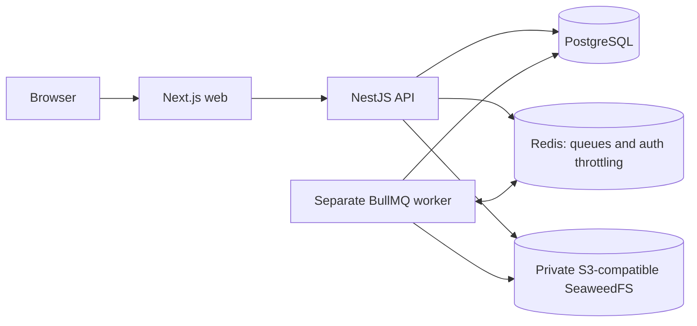

# PuffinPal

A full-stack, multi-tenant business management application built as a personal software engineering portfolio project. PuffinPal connects invoicing, purchasing, expenses and workforce operations through a Next.js interface and a NestJS API.

**Portfolio project • Local demonstration • Not offered as a commercial service**

## Project highlights

- Organization-scoped data access with shared role permissions and backend authorization.
- Financial lifecycles: draft/issued invoices, partial payments, expense/bill approvals, settlements and append-only payable payment reversals.
- PostgreSQL transactions, optimistic versions, payment idempotency and exact money calculations.
- Separate BullMQ workers for recurring invoices, payroll automation, payslips and invoice exports.
- Immutable invoice PDFs, private receipts/attachments and S3-compatible object storage.
- Docker Compose development services and an included Caddy/container deployment configuration.

## Technology stack

| Area                  | Implementation                                                                                             |
| --------------------- | ---------------------------------------------------------------------------------------------------------- |
| Frontend              | Next.js 16, React 19, TypeScript, shared CSS/UI controls, Recharts                                         |
| Backend               | NestJS 11, validated REST DTOs, OpenAPI, PDFKit                                                            |
| Database              | PostgreSQL 16; pinned Prisma 8 release-candidate contract/ORM toolchain                                    |
| Background processing | Redis 7, BullMQ, separate worker entry point                                                               |
| Storage               | SeaweedFS through the AWS S3 SDK                                                                           |
| Infrastructure        | pnpm 11 workspaces, Turborepo, Docker Compose, Caddy                                                       |
| Testing               | Node.js test runner, focused component/event-handler tests, disposable PostgreSQL HTTP integration harness |

The current UI uses repository-owned controls and CSS; Tailwind and Radix are not current application dependencies.

## Features

| Area       | Existing capabilities                                                                                                                               |
| ---------- | --------------------------------------------------------------------------------------------------------------------------------------------------- |
| Revenue    | Clients, draft editing, invoice issuance/PDF download, payment history, partial/full payments, recurring invoice schedules and ZIP exports          |
| Purchasing | Vendors, multi-line bills, attachments, approval/rejection/resubmission, payments/reversals, balances and aging                                     |
| Expenses   | Receipts, approvals, standalone settlements, linked-bill navigation and payment history                                                             |
| Finance    | Currency-isolated dashboard/report aggregates, CSV/PDF reports, deterministic cash-flow forecasts, bank CSV imports and one-to-one reconciliation   |
| People     | Employees, departments, effective-dated salaries, attendance, leave and overtime                                                                    |
| Payroll    | Fixed-salary full-period calculation, workforce imports, configured statutory rules, separate approval/finalization, payment recording and payslips |
| Workspace  | Organization signup/login, team provisioning/roles, account settings and replayable onboarding                                                      |

## Architecture overview



This is a modular monolith with a separate worker process, not a microservice fleet. The API owns authorization, lifecycle rules and transactions; the browser does not choose tenant IDs. PostgreSQL stores business records, audit events and durable job status. Redis handles queue delivery and expiring authentication counters. API/worker processes authorize or generate documents and access private storage.

```text
apps/web        Next.js routes, feature UI and frontend tests
apps/api        NestJS domains, workers, Prisma schema/migrations and API tests
packages        Shared permissions, database runtime, UI and tooling configuration
services        Local PostgreSQL, Redis, SeaweedFS and Adminer
knowledge       Architecture, workflow explanations and demo guide
deploy          Caddy configuration (container setup is at the repository root)
```

See [architecture and request/job/file flows](knowledge/project-architecture.md).

## Engineering challenges

- **Tenant isolation:** authenticated request context supplies the organization; services scope reads/writes to it, and composite foreign keys protect tenant-owned relationships. Permission guards default-deny protected routes without an explicit policy. Isolation is application-enforced, not PostgreSQL RLS.
- **Financial integrity:** PostgreSQL numeric columns and integer minor-unit calculations preserve money precision. Row locks, expected versions and payment idempotency protect supported mutations. Linked bills supply settlement evidence without duplicating expense costs; reversals retain payment history.
- **Asynchronous work:** BullMQ retries and durable database state make document/export processing observable and recoverable. Workers share infrastructure with the API but run independently. This is retry-safe processing, not a blanket exactly-once guarantee.
- **Private documents:** invoice issuance snapshots billing data and stores an immutable PDF. Downloads authorize the record and validate object ownership/integrity. Storage and database writes are not one distributed transaction; staged-object cleanup is best-effort on failure.
- **Business state machines:** payroll creation, calculation, review, approval and finalization have distinct permissions and restrictions. The creator cannot approve their own payroll. Reporting keeps costs, obligations and recorded cash movement separate.

## Local development

Prerequisites: Node.js 24+ (Node 26 used for the latest focused checks), pnpm 11.25.0, Docker with Compose, and GNU Make. Ports 3000, 3001, 5433, 6379, 8080, 8333 and 9333 must be available.

```bash
pnpm install
cp services/.env.example services/.env
cp apps/api/.env.example apps/api/.env
cp apps/web/.env.example apps/web/.env.local
```

Before starting, set a unique `JWT_SECRET` of at least 32 bytes in `apps/api/.env`. One local generation command is:

```bash
node -e 'console.log(require("node:crypto").randomBytes(32).toString("hex"))'
```

Keep database and Redis credentials consistent between the service and API env files; configure S3 credentials to match the local SeaweedFS configuration. Templates contain local examples, not deployment secrets. Never commit populated env files.

For a fresh local database:

```bash
make services.start
make build.packages
make prisma.migrate.deploy
make db.verify
make run
```

`make run` starts web, API and worker tasks. Register a fictional organization through the UI. Migrations apply the committed history; no reset or seed is needed. Existing installations should back up data before schema changes. See [development](knowledge/development.md) for Prisma 8 commands and optional seed behavior.

| Service | Local URL                      |
| ------- | ------------------------------ |
| Web     | http://localhost:3000          |
| API     | http://localhost:3001/api/v1   |
| Swagger | http://localhost:3001/api/docs |
| Adminer | http://localhost:8080          |

Stop application terminals with Ctrl+C; `make services.stop` stops infrastructure without deleting volumes. The [container deployment guide](knowledge/docker-deployment.md) describes the included configuration; its presence is not evidence of a public or production deployment.

### Focused checks

From the repository root, with dependencies and shared packages built:

```bash
pnpm --filter @puffinpal/api exec tsc -p tsconfig.json
pnpm --filter @puffinpal/web exec tsc --noEmit
node --test apps/api/test/invoice-payments.test.mjs apps/api/test/expense-settlement.test.mjs apps/api/test/payroll-calculations.test.mjs apps/api/test/financial-dashboard.test.mjs
node --test apps/web/test/mvp-workflows.test.mjs apps/web/test/workflow-contracts.test.mjs
```

These are focused checks, not a complete end-to-end verification. For existing database-backed invoice workflow checks, start local PostgreSQL/Redis and run:

```bash
node apps/api/scripts/test-auth-e2e.mjs test/invoices.e2e.test.mjs
```

The harness creates, migrates and drops a disposable `puffinpal_auth_test_*` database on the local service. It needs Docker access and never resets the development database. Further workflow checks and browser preparation are listed in the [demo guide](knowledge/portfolio-demo-guide.md).

## Screenshots and demonstration

No application screenshots are currently included; existing PNG assets are logos. Capture these using fictional records and no private information:

- [ ] Financial overview with a reporting period and visible currency
- [ ] Invoice detail showing a partial payment and remaining balance
- [ ] Accounts payable with an approved, partially paid bill
- [ ] Expense detail with settlement or linked-bill navigation
- [ ] Finalized payroll and downloadable payslip
- [ ] Employee directory and salary configuration

The [five-minute demo guide](knowledge/portfolio-demo-guide.md) includes preparation, a timed walkthrough, architecture talking points, tradeoffs and interview questions. Add real screenshots only after browser verification; no mock captures are supplied.

## Project status and boundaries

Active feature development is complete for the portfolio scope. Final screenshots and browser checks remain manual; a public deployment is not claimed. See the [completion record](knowledge/product-development-roadmap.md) and [frozen scope](knowledge/mvp-scope-freeze.md).

This is an operational finance application, not a ledger or statutory accounting system. Currencies are isolated without conversion. Payroll supports fixed salaries for complete periods; it does not provide bank disbursement or maintained country tax content. Invoice/payroll payment reversal, email invitations and self-service password recovery are deferred. Some non-AP lists still cap loaded records. Payment batches are tracking checklists and do not settle payroll.

## Further documentation

- [Authentication, sessions and RBAC](knowledge/authentication.md)
- [Invoice snapshots and storage](knowledge/invoice-pdf-storage.md)
- [Accounts payable and expense settlement](knowledge/accounts-payable-and-expense-payments.md)
- [Recurring invoices](knowledge/recurring-invoices.md)
- [Payroll](knowledge/payroll-management.md) and [configured statutory rules](knowledge/payroll-statutory-deductions.md)
- [Financial reporting definitions](knowledge/financial-reporting.md)
- [Background jobs](knowledge/background-jobs.md)

## License

No license file is included. No open-source license grant is asserted; contact the repository owner about reuse.
