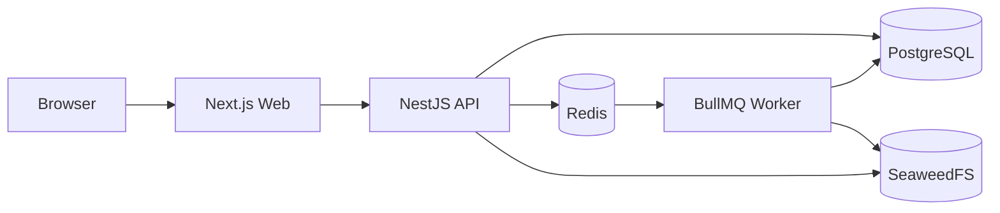
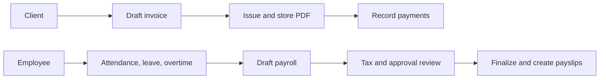

<p align="center">
  
</p>

# PuffinPal

PuffinPal is a multi-tenant business workspace for invoicing, expenses, recurring billing, employees, attendance, leave, payroll, and cash-flow forecasting.

## What it includes

- Client, invoice, payment, and recurring invoice management
- Expense records, receipt storage, and approval workflows
- Employee profiles, departments, salary structures, and payslips
- Attendance, leave, holidays, overtime, and payroll automation
- Configurable payroll tax and statutory deductions
- Financial dashboards and cash-flow forecasts
- Role-based access, tenant isolation, audit history, and guided onboarding

## Architecture



The API handles authorization and business rules. PostgreSQL stores application data, Redis supports queues and rate limits, and SeaweedFS stores private receipts, invoices, exports, and payslips. BullMQ workers process scheduled and document-heavy jobs.

## Tools

| Tool                     | Purpose                                                  |
| ------------------------ | -------------------------------------------------------- |
| Next.js and React        | Web interface and routing                                |
| NestJS                   | REST API, validation, authentication, and business logic |
| Prisma                   | Database schema contracts and migrations                 |
| PostgreSQL               | Business and audit data                                  |
| Redis and BullMQ         | Rate limits, scheduled work, exports, and PDF jobs       |
| SeaweedFS                | Private S3-compatible file storage                       |
| PDFKit                   | Invoice and payslip PDFs                                 |
| pnpm and Turborepo       | Monorepo dependencies and tasks                          |
| Docker Compose and Caddy | Local services and production deployment                 |

## Main workflows



## Run locally

Requirements: Node.js 24+, pnpm 11, Docker Compose, and GNU Make.

```bash
make install
cp apps/api/.env.example apps/api/.env
cp apps/web/.env.example apps/web/.env.local
# Set JWT_SECRET in apps/api/.env before starting the API.
make services.start
make build.packages
make prisma.migrate.deploy
make run
```

`make run` starts the web app, API, and BullMQ worker through Turborepo.

| Service | URL                            |
| ------- | ------------------------------ |
| Web     | http://localhost:3000          |
| API     | http://localhost:3001/api/v1   |
| Swagger | http://localhost:3001/api/docs |
| Adminer | http://localhost:8080          |

Stop local services without deleting their volumes:

```bash
make services.stop
```

## Useful commands

```bash
make run                 # Start web, API, and worker
make lint                # Run lint checks
make typecheck           # Run TypeScript checks
make prisma.migrate.deploy # Apply existing migrations
make database.seed       # Add local development data
```

## Project layout

```text
apps/web       Next.js application
apps/api       NestJS API, workers, migrations, and tests
packages       Shared UI, permissions, database, and configuration
services       Local PostgreSQL, Redis, Adminer, and SeaweedFS
deploy         Caddy configuration
knowledge      Detailed feature and operations guides
```

## Production

The production Compose setup runs Caddy, web, API, worker, PostgreSQL, Redis, and SeaweedFS. Configure `.env.production` from `.env.production.example`, use HTTPS, and replace every example credential before deployment.

See [Docker deployment](knowledge/docker-deployment.md) for migration, backup, TLS, and health-check instructions.

## Documentation

- [Development](knowledge/development.md)
- [Authentication and permissions](knowledge/authentication.md)
- [Invoices and PDF storage](knowledge/invoice-pdf-storage.md)
- [Recurring invoices](knowledge/recurring-invoices.md)
- [Employees](knowledge/employee-management.md)
- [Attendance, leave, and overtime](knowledge/attendance-leave-overtime.md)
- [Payroll](knowledge/payroll-management.md)
- [Payroll statutory deductions](knowledge/payroll-statutory-deductions.md)
- [Background jobs](knowledge/background-jobs.md)
