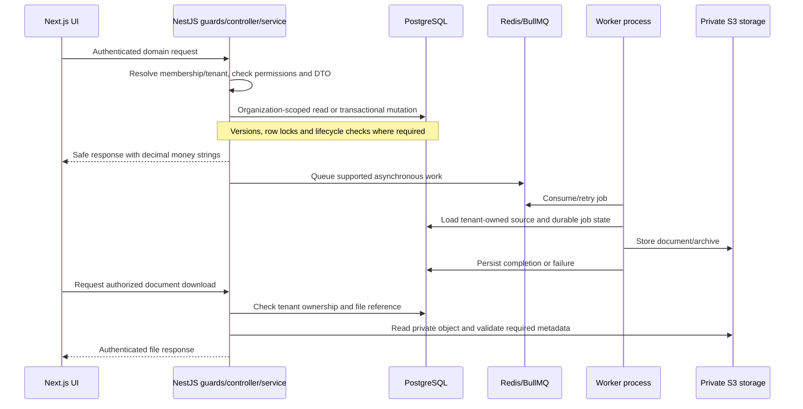

# PuffinPal architecture

## Purchasing and payables

The `accounts-payable` API module owns vendors, bill approval, exact line calculations, private attachments, payments, reversals, aging, and audit history. It extends the existing banking reconciliation record rather than creating a separate matching system. The web feature is composed inside the existing query-driven workspace shell as the Vendors and Accounts Payable pages. See [accounts-payable-and-expense-payments.md](./accounts-payable-and-expense-payments.md).

PuffinPal is a pnpm/Turborepo monorepo. The web app is organized by product feature, while the API separates domain modules from shared infrastructure.

```text
apps/
├── web/
│   ├── src/
│   │   ├── app/
│   │   │   ├── (auth)/          # Public authentication routes
│   │   │   └── (dashboard)/     # Authenticated product routes
│   │   ├── components/
│   │   │   ├── ui/              # Reusable controls and feedback
│   │   │   ├── layout/          # Navigation and application chrome
│   │   │   └── shared/          # Cross-feature composites
│   │   ├── features/            # Feature-owned UI, types, and services
│   │   ├── lib/                 # Cross-cutting clients and helpers
│   │   └── providers/           # Root React providers
│   ├── public/
│   └── test/
└── api/
    ├── prisma/                  # Contract schema and immutable migrations
    └── src/
        ├── common/              # Guards, decorators, and shared types
        ├── infrastructure/      # Database, Redis, queues, and storage
        └── modules/             # NestJS business modules
packages/
├── database/                    # Database contract tooling
├── permissions/                 # Shared RBAC contract
└── ui/                          # Package-level UI primitives
```

The web font lives with the root layout in `apps/web/src/app/fonts`. Invoice PDF fonts live in `apps/api/assets/invoice-pdf` because they are static build inputs rather than API source; the build copies them into the compiled invoice module path.

## Frontend boundaries

- `src/app/layout.tsx` owns the document, metadata, font, global CSS, and root providers.
- Route groups organize public and authenticated routes without changing their URLs.
- Route files stay small and compose feature components. Interactive business behavior belongs to the owning folder under `src/features`.
- `components/ui` contains generic controls, `components/layout` owns application chrome, and `components/shared` contains cross-feature composites. Shared layers must not import a feature.
- Feature code may import shared components and `src/lib`; one feature should not reach into another feature's internals unless it is an explicit composition boundary.
- Use the `@/*` alias for imports rooted at `apps/web/src`. Relative imports are appropriate inside one local feature folder.
- `AppProviders` is the root client-provider boundary. Notifications and snackbars use `NotificationProvider` rather than page-local duplicate state.
- The current workspace uses a query-backed section switcher for compatibility. The dashboard shell is composed once by the workspace feature, while invoice detail routes remain first-class App Router routes.

## Backend boundaries

- `src/modules/<domain>` owns controllers, DTOs, services, and domain-specific helpers.
- Financial reporting lives in `src/modules/financial-reports` and derives read-only aggregates from authoritative domain tables; it does not own duplicate financial records.
- `src/infrastructure` owns technical adapters: PostgreSQL access, Redis, BullMQ workers, and object storage.
- `src/common` contains framework concerns shared by modules, currently authentication decorators, guards, and request types.
- Controllers authorize, validate, and delegate. Services own business invariants and transaction boundaries.
- Domain modules may depend on common and infrastructure layers. Infrastructure must not depend on HTTP controllers.
- Tenant-owned reads and writes include `organizationId`; cross-tenant identifiers fail validation or resolve as not found.
- Money uses fixed-scale database values and integer minor-unit calculations rather than floating point.

## Request, job and document flows



The queue portion applies to asynchronous workflows, not every request. Invoice issuance
renders/stores its immutable PDF synchronously within the issuance workflow; payslips
and invoice ZIP exports use the worker. Redis is not the authoritative financial store.
Database and object storage do not share an atomic transaction; invoice upload cleanup is
best-effort after a failed commit. See [invoice storage](invoice-pdf-storage.md) and
[background jobs](background-jobs.md) for detailed failure behavior.

`apps/api/prisma` owns the Prisma 8 contract, emitted types and migration history.
`packages/database` supplies the PostgreSQL runtime instantiated with that contract.
Domain services use its typed ORM and bound SQL for aggregates/locking. The pinned
release-candidate toolchain uses contract emission and migration packages, rather than
legacy generated Prisma Client conventions. Tenant isolation is application-enforced;
composite keys constrain relationships, but do not replace scoped service queries.

The API modules cover auth/members/settings, clients/invoices/recurring invoices,
expenses/accounts payable, banking/cash-flow/reporting, employees/workforce and payroll.
They share technical adapters while retaining domain-owned financial state machines.
No external payment rails, analytics database or general ledger is present.

## Naming and placement

- Use kebab-case file names and descriptive domain names.
- Keep a type, helper, or component inside its owning feature until it has a real cross-feature responsibility.
- Avoid catch-all `utils` or repository layers that only mirror the database client.
- Add web requests through the existing typed client. Add API capabilities as domain modules registered in `app.module.ts`.

## Validation

- Unit tests live in each app's `test` directory.
- Database-backed flows use the authenticated E2E harness and a disposable database.
- Structural changes must pass lint, type checking, production builds, focused tests, and `git diff --check`.
- Migration history is immutable. Generate and review new additive migration packages separately from source-code refactors.

## Adding a feature

1. Create `apps/api/src/modules/<feature>` with validated DTOs, a service, a controller, and a NestJS module.
2. Register the module in `apps/api/src/app.module.ts`; use existing infrastructure adapters rather than duplicating clients.
3. Create `apps/web/src/features/<feature>` and keep its components, types, and API helpers together.
4. Compose the feature from a small App Router page or the compatible workspace section map.
5. Add permissions to `packages/permissions`, enforce them in the API, and mirror visibility in the UI.
6. Add focused unit tests and tenant-isolation E2E coverage where persistence is involved.
